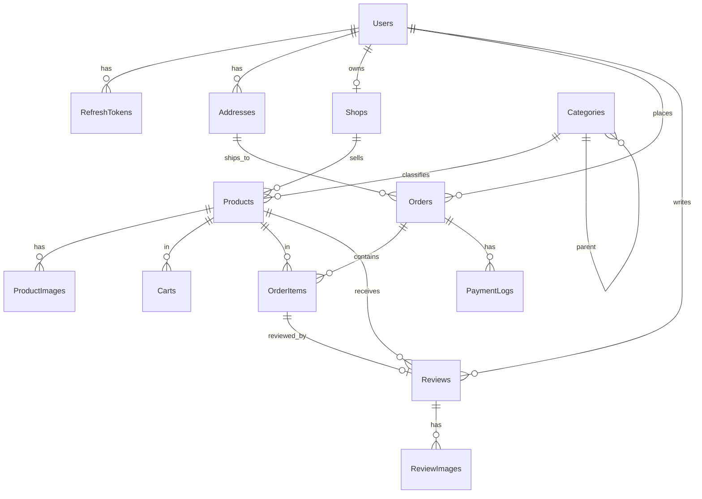
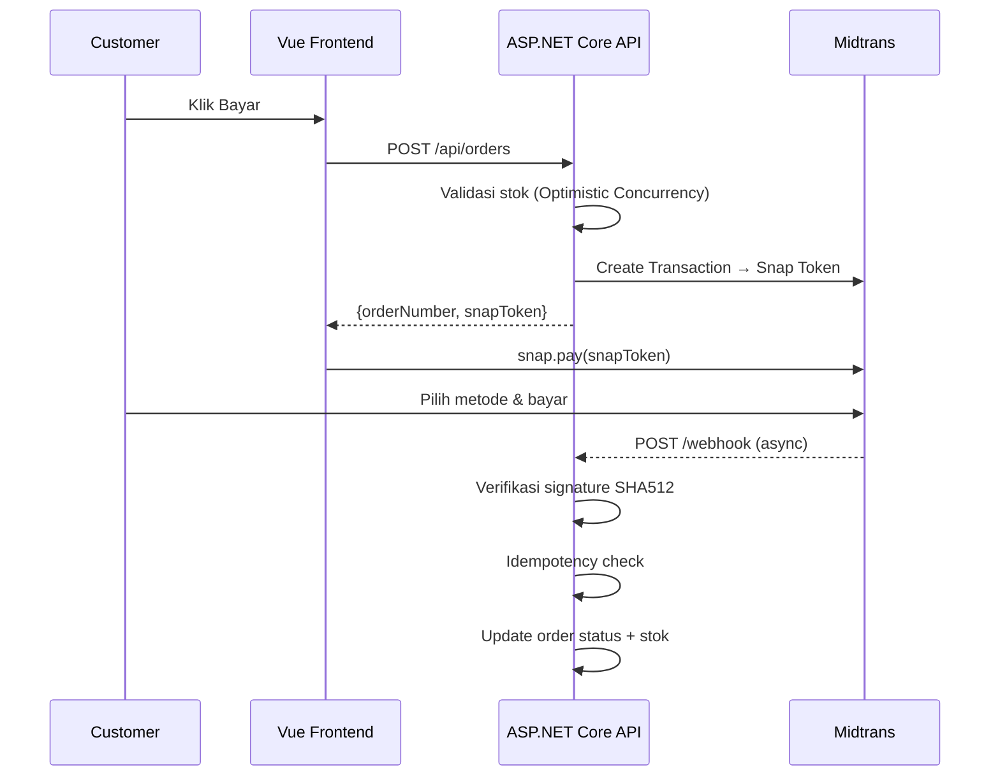

# Marketplace UMKM Jawa Timur

> Platform e-commerce untuk UMKM (Usaha Mikro Kecil Menengah) khas Jawa Timur — seller bisa menjual produk lokal, customer bisa membeli dengan pembayaran online via Midtrans.

**Proyek Portofolio** | Full-Stack: ASP.NET Core 8 + Vue 3

---

## Tech Stack

| Layer | Teknologi |
|---|---|
| **Backend** | ASP.NET Core 8, EF Core 8, SQL Server 2022 |
| **Auth** | ASP.NET Core Identity, JWT + Refresh Token (HttpOnly Cookie) |
| **Architecture** | Clean Architecture (Domain → Application → Infrastructure → API) + MediatR (CQRS) |
| **Mapping** | Mapster |
| **Validation** | FluentValidation (via MediatR Pipeline) |
| **Background Job** | .NET BackgroundService (order expiry) |
| **Payment** | Midtrans Snap (Sandbox) |
| **Logging** | Serilog |
| **Frontend** | Vue 3 (Composition API), TypeScript, Vite |
| **State** | Pinia |
| **Styling** | Tailwind CSS |
| **Testing** | xUnit, FluentAssertions, Testcontainers, Moq, Vitest, Playwright |
| **DevOps** | Docker Compose, GitHub Actions |

---

## Fitur Utama

- 🔐 Autentikasi JWT + refresh token, role (Admin / Seller / Customer)
- 🛍️ Katalog produk: search, filter, sort, pagination server-side
- 🛒 Keranjang belanja tersimpan di database
- 💳 Checkout + ongkir (mock RajaOngkir) + bayar via Midtrans Snap
- 📦 Status order: pending → paid → processed → shipped → completed
- 🔔 Webhook Midtrans dengan verifikasi signature + idempotency
- ⚡ Kontrol stok dengan optimistic concurrency (EF Core RowVersion)
- ⏰ Background job: auto-expire order & rollback stok
- ⭐ Review produk dengan upload foto
- 🏅 Badge "Produk Asli Jatim" diverifikasi admin
- 📊 Dashboard seller & admin dengan grafik penjualan

---

## ERD



---

## Arsitektur Layer

```
┌─────────────────────────────────────────┐
│  API Layer (Controllers, Middleware)     │  ← HTTP in/out, thin controllers
├─────────────────────────────────────────┤
│  Application Layer (MediatR, Use Cases) │  ← Business logic, CQRS handlers
├─────────────────────────────────────────┤
│  Infrastructure Layer                   │  ← EF Core, Identity, Midtrans, etc.
├─────────────────────────────────────────┤
│  Domain Layer (Entities, Interfaces)    │  ← Core business rules, no deps
└─────────────────────────────────────────┘
```

Dependency arah: API → Application → Domain ← Infrastructure

---

## Alur Pembayaran



---

## Cara Menjalankan Lokal

### Prasyarat
- Docker & Docker Compose
- Git

```bash
git clone https://github.com/username/umkm-jatim.git
cd umkm-jatim
cp .env.example .env
# Edit .env: isi MIDTRANS_SERVER_KEY, JWT_SECRET, dll.

docker compose up --build
```

Setelah selesai:
- **API**: http://localhost:5000
- **Swagger**: http://localhost:5000/swagger
- **Frontend**: http://localhost:3000

### Akun Demo

| Role | Email | Password |
|---|---|---|
| Admin | admin@umkmjatim.id | Admin@12345 |
| Seller 1 | toko.surabaya@umkmjatim.id | Seller@12345 |
| Seller 2 | toko.malang@umkmjatim.id | Seller@12345 |
| Customer | customer1@test.id | Customer@12345 |

---

## Keputusan Teknis

### 1. Clean Architecture
Memisahkan concern secara tegas: Domain tidak tahu apapun tentang HTTP/DB, Application layer hanya bergantung pada abstraksi (interface). Ini membuat business logic mudah di-test secara unit tanpa database atau HTTP.

### 2. JWT + Refresh Token via HttpOnly Cookie
Access token (15 menit) dikirim sebagai Bearer di header. Refresh token (7 hari) disimpan di HttpOnly cookie — tidak bisa dibaca JavaScript, mitigasi serangan XSS. Saat access token expired, frontend otomatis hit `/api/auth/refresh` via Axios interceptor.

### 3. Optimistic Concurrency (Bukan UPDLOCK)
Stok dikontrol dengan EF Core `RowVersion` (SQL Server `rowversion`). Jika dua request checkout bersamaan untuk produk yang sama, salah satu akan dapat `DbUpdateConcurrencyException` dan di-retry. Ini lebih scalable dari `SELECT ... WITH (UPDLOCK)` yang memblokir baris — cocok untuk produk yang tidak terlalu viral. Trade-off didokumentasikan di [`docs/adr/003-optimistic-concurrency.md`](docs/adr/003-optimistic-concurrency.md).

### 4. Webhook Midtrans dengan Idempotency
Midtrans bisa mengirim webhook lebih dari sekali untuk transaksi yang sama. Setiap notifikasi dicek di tabel `PaymentLogs` berdasarkan `transactionId` (unique index). Jika sudah ada, langsung return 200 tanpa memproses ulang. Signature SHA512 diverifikasi sebelum memproses apapun.

---

## Fase Pengerjaan

- [x] **Fase 1**: Setup solution, Auth (JWT + refresh token), Identity, DB migrations, Seeder
- [ ] **Fase 2**: Katalog produk, manajemen produk seller (API + UI)
- [ ] **Fase 3**: Keranjang + Checkout + Ongkir
- [ ] **Fase 4**: Midtrans + Webhook + Background Job expired order
- [ ] **Fase 5**: Dashboard admin/seller + Review + Upload foto
- [ ] **Fase 6**: Testing lengkap, CI/CD, Docker, Dokumentasi final

